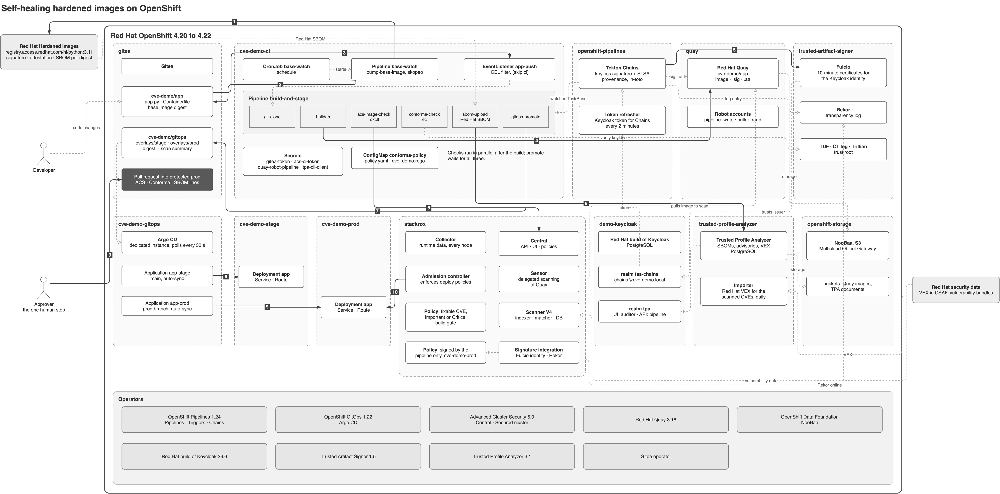

# BO1122: self-healing images on OpenShift

Red Hat One 2027 session demo. When Red Hat publishes a new [Red Hat Hardened Images](https://developers.redhat.com/articles/2026/06/29/red-hat-ubi-vs-red-hat-hardened-images-how-to-choose?sc_cid=RHCTG0260000488735#) base image,
the pipeline rebuilds, signs, checks and stages the application by itself. Production changes only
when a person approves one pull request.

```
base-watch (scheduled)   new hi/python:3.11 digest?  -> commit to cve-demo/app
   │ Gitea webhook
build-and-stage          clone -> buildah -> push to Red Hat Quay
   │                     [Tekton Chains: keyless signature + SLSA provenance via Trusted Artifact Signer, Rekor]
   │                     -> ACS scan gate ∥ Conforma release policy ∥ SBOM into Trusted Profile Analyzer
   │                     -> stage overlay on main (Argo CD syncs) -> pull request into prod
approver merges          -> Argo CD rolls out prod (protected prod branch)
                         -> ACS admission: only images signed keyless by the pipeline may run
```

## Overview


The numbered arrows and the dashed supporting-data arrows are explained in
[diagrams/demo-overview.md](diagrams/demo-overview.md). The editable source is `diagrams/demo-overview.drawio`,
generated by `diagrams/gen_overview.py`.

## Products used
| Product | Role in the demo |
|---|---|
| Red Hat Hardened Images | the base image (`registry.access.redhat.com/hi/python:3.11`), with Red Hat's signature and SBOM |
| Red Hat OpenShift Pipelines (Tekton, Triggers, Chains) | base-watch and build-and-stage; Chains signs every build |
| Red Hat Quay (on NooBaa object storage from OpenShift Data Foundation) | image, signature, attestation; robot accounts per role |
| Red Hat Trusted Artifact Signer | keyless signing (Fulcio certificate for the pipeline identity), Rekor transparency log, TUF trust root |
| Red Hat build of Keycloak | identities: Chains' signing identity (realm `tas-chains`), Trusted Profile Analyzer logins (realm `tpa`) |
| Conforma | release policy before the prod pull request (`manifests/09-pipeline/conforma/`) |
| Red Hat Trusted Profile Analyzer | Red Hat's SBOM of the base, matched against Red Hat's VEX |
| Red Hat Advanced Cluster Security | build gate (fixable Important/Critical CVEs), admission: keyless-signed images only in prod |
| Red Hat OpenShift GitOps | stage and prod from the gitops repository |
| Gitea (demo tooling, not a Red Hat product) | stands in for the customer's Git server |

Red Hat Developer Hub is part of Red Hat Advanced Developer Suite but not used in this demo.

## Quickstart: empty OpenShift cluster

Requirements:
- cluster-admin on OpenShift 4.20, 4.21 or 4.22, a default StorageClass
- workers with at least 16 cores and 48 GiB allocatable in total, and about 300 GiB of volumes on a fresh install
- outbound access to quay.io, registry.access.redhat.com, registry.redhat.io, security.access.redhat.com
- a route certificate the nodes trust (nodes pull the demo images from Quay's route); the first step
  prints the fix if it is not publicly trusted
- on the laptop: `oc`, `git`, `curl`, `python3`, `openssl`

```bash
oc login --server=https://api.<cluster>:6443 -u <cluster-admin>
cp .env.example .env        # adjust only if needed, e.g. ACS already installed elsewhere
./setup.sh                  # about an hour, set by the first ACS vulnerability load
```

`setup.sh` runs the phases in `phases/`, each with its manifests in the matching `manifests/` folder, then
`verify.sh`. Every phase is safe to re-run: `./setup.sh --from N` resumes, `./setup.sh --only N` repeats one.
Operators and products already on the cluster are used as they are and never changed; preflight shows the plan.
Run `phases/00-preflight.sh` on its own to see it without installing anything.

| Phase | What it does |
|---|---|
| 00 preflight | read-only: tools, login, storage, capacity, route certificate, egress; lists which operators and products are reused and which get installed, and stops on conflicts before anything changes |
| 01 operators | operators pinned to validated versions with Manual install-plan approval, a pin-guard admission policy that warns on unpinned ones; never adds a second OperatorGroup |
| 02 storage | NooBaa, standalone Multicloud Object Gateway, lean |
| 03 acs | ACS Central and secured cluster, demo-sized; the first vulnerability load, about 45 minutes, runs on while the next phases install |
| 04 quay | Quay on NooBaa, organisation `cve-demo`, robot accounts |
| 05 keycloak | Keycloak with PostgreSQL, realm `tas-chains`, Chains' signing identity |
| 06 tas | Trusted Artifact Signer: Fulcio, Rekor, CT log, TUF; token refresher; Chains keyless |
| 07 tpa | realm `tpa`, PostgreSQL, NooBaa bucket, Trusted Profile Analyzer |
| 08 gitea | Gitea, organisation `cve-demo`, repositories, users `pipeline-bot` and `approver` |
| 09 pipeline | demo namespaces, Quay and TPA secrets, ACS integrations, tasks, pipelines, Conforma policy |
| 10 gitops | Argo CD, repositories, webhooks, protected prod branch; waits for ACS vulnerability data, smoke-tests a scan; one build on the old base approved into prod as the baseline; policies enforced; TPA importer |

`cleanup.sh` removes the demo layer, `cleanup.sh --platform` also every product setup installed; anything it
did not install stays.

Where things are afterwards:
| What | URL | Login |
|---|---|---|
| Gitea | `https://gitea-gitea.<apps domain>/cve-demo` | user `approver`: `oc get secret gitea-approver -n cve-demo-ci -o jsonpath='{.data.password}' \| base64 -d` |
| App | `https://app-cve-demo-stage.<apps domain>`, `https://app-cve-demo-prod.<apps domain>` | page shows the ACS result for its image |
| Quay | `https://registry-quay-quay.<apps domain>/repository/cve-demo/app` | user `quayadmin`: secret `quay-admin` in `quay` |
| Trusted Profile Analyzer | `https://server-trusted-profile-analyzer.<apps domain>` | user `auditor`: `oc get secret tpa-auditor -n demo-keycloak -o jsonpath='{.data.password}' \| base64 -d` |
| Rekor (log entries) | `https://rekor-server-trusted-artifact-signer.<apps domain>/api/v1/log/entries?logIndex=<n>` | public |
| ACS | `https://central-<ACS_NS>.<apps domain>` | user `admin`: secret `central-admin-password` |
| Keycloak admin | `https://keycloak-demo-keycloak.<apps domain>` | secret `keycloak-initial-admin` in `demo-keycloak` |

## Running the demo
All in `demo/cve-fire-drill/`:
1. Start: prod and stage show the baseline, "ACS at build: 45 fixable Important/Critical CVEs"; the number
   moves with new vulnerability data, check it the morning of a recording.
2. The advisory arrives: `run.sh` starts base-watch and follows the build.
3. Hands off: build-and-stage runs by itself; stage shows 0 fixable; a pull request into prod appears with
   three lines: the ACS result, "Conforma: passed", and the SBOM link into Trusted Profile Analyzer.
4. The one click: log in to Gitea as `approver`, Files changed → Review → Approve, then merge. Fallback: `approve.sh`.
5. Prod shows 0 fixable about a minute after the merge.
6. Back to the start: `reset.sh`, under a minute, no rebuild. `cycle-test.sh` runs the whole cycle unattended.

## Tools
| Tool | Use |
|---|---|
| `tools/task-test.sh <task> [image]` | run `conforma-check`, `sbom-upload` or `acs-image-check` once against an image |
| `tools/conforma-probe.sh [image]` | show the policy input Conforma sees |
| `tools/fulcio-test.sh` | ask Fulcio for a certificate with Chains' Keycloak identity |
| `tools/tpa-api.sh <METHOD> <path>` | call the Trusted Profile Analyzer API as the pipeline's client |
| `tools/keycloak-reimport.sh <realm>` | re-import a realm after its manifest changed, restarting what caches its keys |
| `tools/footprint.py` | CPU and memory the demo requests |
